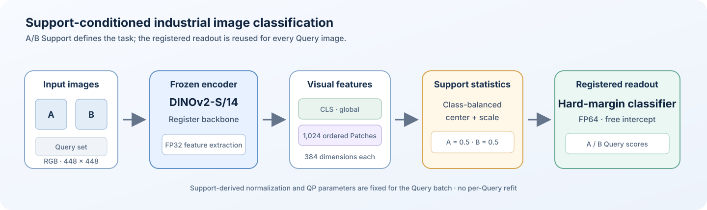
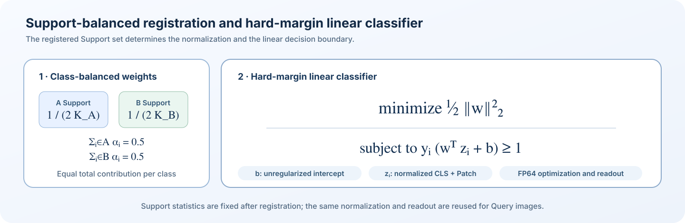

<div align="center">

# Support-Conditioned Vision

**Support-conditioned industrial image classification with frozen DINOv2 features and a hard-margin linear classifier.**

[](https://www.python.org/)
[](https://pytorch.org/)
[](https://github.com/facebookresearch/dinov2)
[](https://github.com/meamaturinlove221/support-conditioned-vision/stargazers)

[Overview](#overview) · [Architecture](#architecture) · [Quick start](#quick-start) · [Input and output](#input-and-output) · [Scope](#release-scope)



</div>

## Overview

Support-Conditioned Vision performs **task-conditioned A/B classification**. A pair of labelled Support sets defines the classification task; the resulting classifier is then applied to a separate Query set.Learn more at https://www.yuque.com/maturinlove221/nq2gn9/pxhlnttxotq1ydqs?singleDoc# 

## Results

We achieved 98.12% accuracy on a real industrial image test set.

## Architecture

The same frozen visual encoder is shared by Support and Query images. The Support labels define a task-specific decision boundary; a different Support set produces a different classifier without changing the DINOv2 weights.


### 1. Image encoding

Each image is decoded as RGB, resized directly to 448 × 448 with bilinear interpolation, and normalized with ImageNet channel statistics. The full image is encoded; this path does not apply a detector, segmentation mask, or center crop.

The encoder is Meta's **DINOv2 ViT-S/14 with Registers**. Its 12 Transformer blocks, 384-dimensional hidden representation, and six attention heads produce two feature blocks:

| Feature | Shape | Role |
|---|---:|---|
| CLS | `384` | Global representation of the full image |
| Patch | `1,024 × 384` | Spatially ordered local representations from the 32 × 32 patch grid |

The four Register tokens are part of the Transformer input but are not included in the returned CLS/Patch feature blocks. The backbone remains frozen; inference feature extraction uses FP32.

### 2. Support registration

Let the Support set contain `K_A` images in class A and `K_B` images in class B. Each image is assigned a class-balanced weight:

- A image: `1 / (2 K_A)`
- B image: `1 / (2 K_B)`

Each class therefore contributes a total weight of 0.5. This prevents the larger Support class from dominating the feature statistics.

CLS and Patch are processed separately. For each block, registration computes a weighted common center and one scale for the whole block, then normalizes every Support feature with those values. The normalized blocks are concatenated into one feature vector per image.

Registration then fits a **hard-margin linear classifier** from the Support labels. Its objective minimizes the squared length of the classification vector while requiring every labelled Support image to have a signed margin of at least one. The intercept is free and is not included in the norm penalty.

<p align="center"></p>

The implementation solves the dual problem with SciPy SLSQP, applies an active-set correction from the KKT conditions, and evaluates the returned classifier against every Support image. A registration is accepted only when the solver succeeds and the Support constraints pass the numerical checks. Optimization and classification use FP64.

### 3. Query classification

After registration, the classifier stores the two feature-block centers and scales, the linear coefficient, and the intercept. Query images pass through the same frozen encoder and the same normalization values. The classifier returns A/B scores from the signed linear margin; no statistics or classifier parameters are refitted on Query images.

### 4. Registration consistency

The optional `--verify-swap` check registers the same images with A and B exchanged. It checks that the score columns exchange while the physical class prediction remains consistent.

## Quick start

### Requirements

- Python 3.10 or later
- PyTorch 2.4 or later
- Pillow, NumPy, SciPy
- The official DINOv2 source and ViT-S/14 Register checkpoint

Install PyTorch using the [official selector](https://pytorch.org/get-started/locally/) for your CUDA or CPU environment, then install the remaining dependencies:

```bash
git clone https://github.com/meamaturinlove221/support-conditioned-vision.git
cd support-conditioned-vision

python -m venv .venv
# Windows
.venv\Scripts\activate
# Linux / macOS
# source .venv/bin/activate

python -m pip install -r requirements.txt
```

### Prepare DINOv2

Clone the official [DINOv2 repository](https://github.com/facebookresearch/dinov2) and obtain the ViT-S/14 Register checkpoint:

- Model: `dinov2_vits14_reg`
- Checkpoint: [dinov2_vits14_reg4_pretrain.pth](https://dl.fbaipublicfiles.com/dinov2/dinov2_vits14/dinov2_vits14_reg4_pretrain.pth)

Copy the public configuration template:

```bash
# Windows PowerShell
Copy-Item configs/models.example.json configs/models.local.json

# Linux / macOS
# cp configs/models.example.json configs/models.local.json
```

Set the local paths in `configs/models.local.json`:

```json
{
  "default": {
    "checkpoint": "C:/models/dinov2_vits14_reg4_pretrain.pth",
    "official_source": "C:/repos/dinov2"
  },
  "custom": {
    "checkpoint": "C:/models/dinov2_vits14_reg4_pretrain.pth",
    "official_source": "C:/repos/dinov2",
    "adapter_checkpoint": "C:/models/adapter.pt"
  }
}
```

The custom adapter is optional. No backbone or adapter weights are distributed in this repository.

## Input and output

### Support manifest

A Support manifest is a JSON object with an `entries` array. Each entry contains an image path and its class role.

```json
{
  "entries": [
    {"path": "support/A/001.png", "role": "NG"},
    {"path": "support/A/002.png", "role": "NG"},
    {"path": "support/B/001.png", "role": "OK"},
    {"path": "support/B/002.png", "role": "OK"}
  ]
}
```

Supported roles include `NG` / `OK` and `A` / `B`. Relative paths are resolved against the manifest directory.

### Run inference

The public routing table uses generic sample folder identifiers. Place the Query images under the matching `Difficult/<sample>` folder, or explicitly select a registered sample product.

```powershell
python infer.py `
  --model-version default `
  --support-manifest "C:/data/support.json" `
  --query-dir "C:/data/Difficult/sample_generic/test" `
  --output-dir runs/sample_inference `
  --device cuda `
  --verify-swap
```

### Run validation

For validation, arrange labelled Query images in class subfolders:

```text
query/
├── NG/
│   ├── image_001.png
│   └── image_002.png
└── OK/
    ├── image_003.png
    └── image_004.png
```

Then run:

```powershell
python validate.py `
  --model-version default `
  --support-manifest "C:/data/support.json" `
  --query-dir "C:/data/query" `
  --output-dir runs/sample_validation `
  --verify-swap
```

### Outputs

Each run writes:

| File | Contents |
|---|---|
| `predictions.csv` | Per-image A/B scores and predictions |
| `summary.json` | Model identity, route, Support counts, and swap verification |
| `metrics.json` | Validation confusion matrix, accuracy, per-class recall, and balanced accuracy (validation only) |

## Product routing

The public source uses example product identifiers to demonstrate directory-based routing:

| Query path | Route |
|---|---|
| `Difficult/sample_generic` | Generic DINOv2 + hard-margin linear classifier |
| `Difficult/sample_part_a` | Generic DINOv2 + hard-margin linear classifier |
| `Difficult/sample_part_b` | Generic DINOv2 + hard-margin linear classifier |
| Unknown or conflicting product folders | `REVIEW` |

These identifiers are sample folder names. Routing uses the folder name or an explicit `--product` selection.

## Repository layout

```text
configs/
  models.example.json       Public model-path template
model/
  README.md                 Local model input requirements
src/
  confirmed_support/        Support statistics and FP64 hard-margin linear classifier
  frozen_dino/              Frozen DINOv2 encoder and adapter loader
  inference/                Inference engine and registration profiles
  task_selection/            Example directory-based routing
infer.py                     Query inference
validate.py                  Labelled Query validation
```

## Release scope and limitations

- This repository contains the generic A/B inference and validation source only.
- Desktop UI, web UI, LoRA training workflow, customer-specific product routing, and cylinder quantity research are not included in this public source edition.
- The public routing identifiers are generic examples.
- Prepare the official DINOv2 backbone checkpoint locally; provide an optional LoRA adapter from an authorized source.
- Industrial images, Support/Query datasets, registration archives, and experiment outputs remain external to the public source.
- Cylinder quantity experiments are maintained separately from this generic classification release.

## Related project

Generate synthetic A/B image groups and manifests with [Industrial Image Synthesis](https://github.com/meamaturinlove221/industrial-image-synthesis). Organize the generated images into Support and Query sets, then use this repository to register the classifier and evaluate Query images.

## References

- Oquab et al., [DINOv2: Learning Robust Visual Features without Supervision](https://arxiv.org/abs/2304.07193).
- Darcet et al., [Vision Transformers Need Registers](https://arxiv.org/abs/2309.16588).
- [Official DINOv2 implementation and pretrained models](https://github.com/facebookresearch/dinov2).

## License

This repository currently has no `LICENSE` file. Public visibility does not by itself grant permission to use, modify, or redistribute this project's code.

The upstream [DINOv2 repository](https://github.com/facebookresearch/dinov2) lists its code and pretrained model weights under Apache 2.0. That upstream license applies to the DINOv2 materials, not automatically to this repository. Review the upstream license and model terms when preparing a deployment or redistribution.
