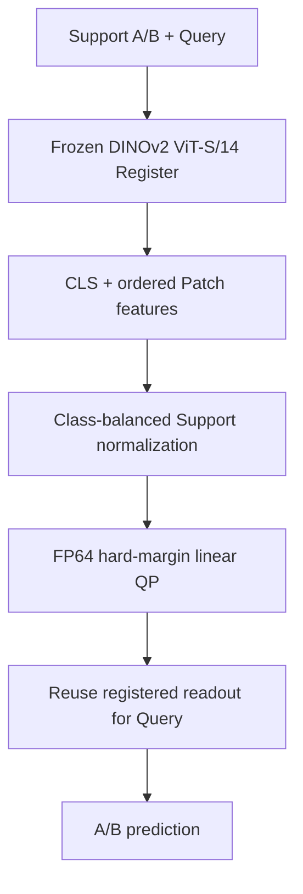

# Support-Conditioned Vision

> **Repository status:** this GitHub landing commit currently contains project documentation and publishing instructions. The complete source archive is prepared separately; run `publish.ps1` from the extracted archive to push the source tree to `main`.

Support-conditioned industrial image classification with a frozen DINOv2 encoder, class-balanced Support registration, a hard-margin linear QP readout, and product-aware task routing.

> **Release status:** the generic A/B classification path is included. The cylinder quantity branch is research-only and is not approved for deployment. Its quantity readout checkpoint is not included in this release.

## What it does

Two labelled Support sets define the current A/B task; the registered classifier is then applied to Query images.

- **Registration:** manually select or sample Support images, register A/B, compare adapters, save profiles, and inspect per-image predictions.
- **Validation:** evaluate a registration against labelled NG/OK or A/B folders and export predictions and metrics.
- **Training:** run the configured LoRA training workflow when its matching data contract and local resources are available.

The desktop UI uses Tkinter. An optional local web UI exposes the same workflows.

## Generic classification pipeline



- RGB input resized to 448 × 448.
- DINOv2 ViT-S/14 Register; hidden dimension 384; 32 × 32 Patch grid.
- One CLS vector and 1,024 ordered Patch vectors.
- A and B receive equal total weight in Support normalization.
- The hard-margin linear classifier has an unregularized intercept and is solved in FP64.
- Query images reuse the Support-derived normalization and classifier.

Three LoRA adapters modify Q/V projections in Transformer Blocks 10 and 11 (rank 4, alpha 4). The DINOv2 backbone remains frozen.

## Product routing

Routing uses the `Difficult/<product>` folder or an explicit product selection. It is directory-based routing, not an image-content recognition network.

| Product folder | Route |
|---|---|
| `特斯拉` and registered variants | Generic DINOv2 + QP |
| `甲片` | Generic DINOv2 + QP |
| `金属膨胀螺丝1` | Generic DINOv2 + QP |
| `圆柱轴` | Quantity research branch |
| Unknown or conflicting product folders | `REVIEW` |

## Installation (Windows)

Requirements: 64-bit Windows, Python 3.12 with Tcl/Tk, Git, and a compatible NVIDIA CUDA runtime (or CPU-only PyTorch).

```powershell
py -3.12 deployment/setup.py --plan --device cuda
py -3.12 deployment/setup.py --install --device cuda
# or: py -3.12 deployment/setup.py --install --device cpu
py -3.12 deployment/setup.py --check
.\start_ui.cmd
```

The installer creates a project-local `.venv` and prepares the pinned official DINOv2 source and pretrained backbone outside this repository. Exact versions and upstream references are in `deployment/manifest.json`.

Optional web UI:

```powershell
Copy-Item configs/web.example.json configs/web.local.json
.\start_web.cmd
```

The web server has no built-in authentication. Keep it on localhost or a trusted, access-controlled network.

## Quantity branch: research-only

The cylinder rule is `1 → OK`, `0 or 2 → NG`. The current readout domain is exactly `{0, 1, 2}`; there is no separate `3+` class.

The Parent400 adapter is included as `support_optimized_2_training.pt`. The separate `quantity_parent400_lambda1.pt` readout checkpoint and its fitting script are not included. The current quantity registration path also does not use NG Support image content in the quantity readout. Reliability is `QUANTITY_RELIABILITY_NOT_VERIFIED`, `deploy_allowed=false`; formal inference returns `REVIEW`.

## Related project

The paired synthetic-data generator is maintained separately in [Industrial Image Synthesis](https://github.com/meamaturinlove221/industrial-image-synthesis). The projects exchange image groups and manifests; they do not call each other at runtime.

## Data and license

Industrial images, Support/Query datasets, generated runs, and local configuration files are not included. Copy `.example.json` files to `.local.json` and configure local paths.

No license is included in this initial publication. Public visibility alone does not grant permission to reuse or redistribute the code or model weights.
