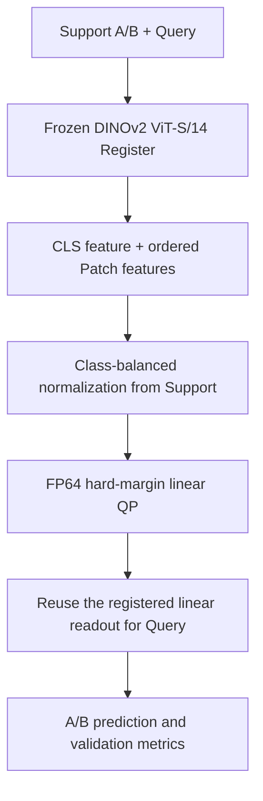

# Support-Conditioned Vision

Support-conditioned industrial image classification with a frozen DINOv2 encoder, class-balanced Support registration, a hard-margin linear QP readout, and product-aware task routing.

> **Release status:** this source-only edition includes the generic A/B classification and validation paths. It does not include customer-specific workflows, model weights, data, training, or application interfaces.

## What it does

The application uses two labelled Support sets to define the current A/B task, then applies the registered classifier to Query images.

- **Registration and inference:** register A/B from a fixed Support manifest or reload a compatible registration profile, then export per-image Query predictions.
- **Validation:** evaluate a fixed registration against labelled NG/OK or A/B inputs, exporting predictions and metrics.

## Generic classification pipeline



- Input: RGB images resized to 448 × 448.
- Encoder: DINOv2 ViT-S/14 Register, 384-dimensional hidden representation, 32 × 32 Patch grid.
- Features: one CLS vector and 1,024 ordered Patch vectors.
- Registration: A and B receive equal total weight when estimating normalization statistics.
- Readout: hard-margin linear classification with an unregularized intercept, solved in FP64.
- Inference: Query images reuse the Support-derived normalization and classifier; the QP is not re-fit for each Query.

A compatible optional local LoRA adapter modifies Q/V projections in Transformer Blocks 10 and 11 (rank 4, alpha 4). The DINOv2 backbone remains frozen.

## Product routing

The router selects a task from the `Difficult/<product>` path or an explicit product selection. It is directory-based routing, not an image-content recognition network.

| Product folder | Route |
|---|---|
| `sample_generic` | Generic DINOv2 + QP |
| `sample_part_a` | Generic DINOv2 + QP |
| `sample_part_b` | Generic DINOv2 + QP |
| Unknown or conflicting product folders | `REVIEW` |

The folder labels above are examples, not real product identifiers.

## Installation (Windows)

Requirements: Python 3.10 or later and a compatible PyTorch runtime for your machine.

```powershell
py -3 -m venv .venv
.\.venv\Scripts\python.exe -m pip install -r requirements.txt
Copy-Item configs/models.example.json configs/models.local.json
```

Obtain the [official DINOv2 source and ViT-S/14 Register checkpoint](https://github.com/facebookresearch/dinov2) separately and enter their local paths under `default` in `configs/models.local.json`. For GPU-specific PyTorch builds, follow the upstream PyTorch installation instructions. The bundled installer and launchers are not part of this edition. Runtime and prediction quality were not validated as part of release preparation.

## CLI

Generic inference from a fixed Support manifest:

```powershell
.\.venv\Scripts\python.exe infer.py `
  --model-version default `
  --support-manifest "C:/example/support.json" `
  --query-dir "C:/example/Difficult/sample_generic/test" `
  --output-dir runs/example_infer `
  --device cuda `
  --verify-swap
```

Validation with labelled NG/OK subfolders:

```powershell
.\.venv\Scripts\python.exe validate.py `
  --model-version default `
  --support-manifest "C:/example/support.json" `
  --query-dir "C:/example/Difficult/sample_generic/test" `
  --output-dir runs/example_validation `
  --verify-swap
```

A Support manifest is a JSON object with an `entries` array. Each entry has a `path` and a `role` (default class labels: `NG` and `OK`). Relative Support paths resolve against the manifest directory. See `infer.py --help` and `validate.py --help` for options.

## Included model files

No weights or checkpoints are included. See [`model/README.md`](model/README.md) for compatible local inputs. The official DINOv2 backbone is an external dependency and is not duplicated in this repository.

## Research scope

This edition is limited to generic A/B classification and validation. Specialized rules and research training are outside the release.

## Repository layout

```text
configs/                 Public configuration template
src/confirmed_support/   Support statistics and FP64 QP solver
src/frozen_dino/         Frozen DINOv2 encoder and LoRA adapters
src/inference/           Shared inference engine and registration sessions
src/task_selection/      Example product-directory task routing
model/                  Local model input instructions
```

## Data and privacy

Industrial images, Support/Query datasets, generated runs, local configuration files, and experiment outputs are not included. Copy the `.example.json` files to `.local.json` and fill in local paths. Local files are ignored by Git.

## Related project

The paired synthetic-data generator is maintained separately in [Industrial Image Synthesis](https://github.com/meamaturinlove221/industrial-image-synthesis). The two projects exchange image groups and manifests; they do not call each other at runtime.

## License

No license is included in this initial publication. Public visibility alone does not grant permission to reuse, modify, or redistribute the code or model weights. Add a license only after confirming the project ownership and distribution terms.
